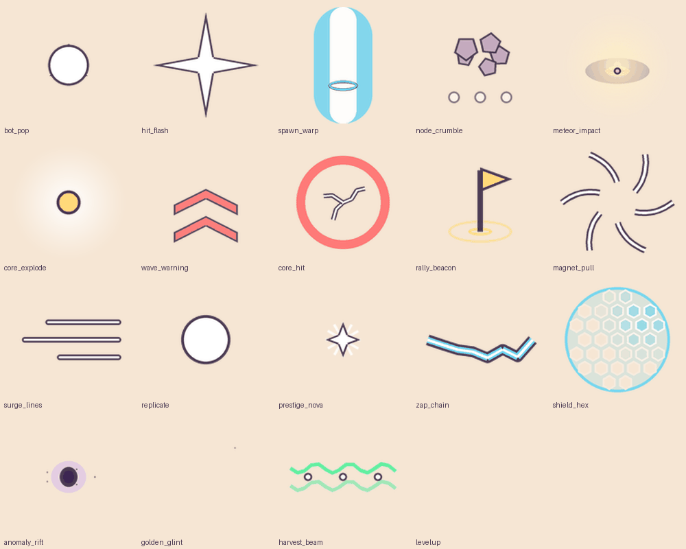

# VFX 2D vẽ bằng code (flipbook, particle, atlas)

Lấy từ NanoSwarm. **Không cần GPU, không cần AI** — chỉ Python + Pillow. Vì sao vẽ bằng code: thử ComfyUI cho VFX
thì ~50% ra sai vật (sét → gấu hồng) mà bộ chấm vẫn "nhận" — xem [`docs/knowledge/lessons-vfx.md`](../docs/knowledge/lessons-vfx.md).



| Script | Ra gì |
|---|---|
| `draw_explore.py` | **19 hiệu ứng** flipbook (nổ, trúng đòn, spawn, khiên lục giác, nova, cảnh báo, sét nối…) + 24 nhân vật mẫu |
| `vfx_preview.py` | xem VFX **đang chạy**: gif tất cả, gif từng cái (nền sáng \| tối), gif cỡ thật 24/48/96px |
| `draw_vfx_sprites.py` | bộ VFX UI + atlas 4×4 cho ParticleSystem |
| `draw_match_fx.py` | atlas 8×8 hiệu ứng trận đấu |
| `draw_summon_fx.py` | hiệu ứng màn triệu hồi gacha (sao, bong bóng, confetti, cột sáng) + card back |

```bash
pip install pillow
python3 vfx/vfx_preview.py draw_explore out/vfx          # → out/vfx/vfx_all_anim.gif (mở bằng Safari/Chrome để thấy chạy)
VFX_OUT=out/vfx-ui python3 vfx/draw_vfx_sprites.py out/vfx-ui   # PNG từng frame + atlas + contact sheet
```

## Hợp đồng một hiệu ứng (thêm hiệu ứng mới)

```python
def fx_<tên>(n=6):              # trả list frame RGBA 128px
    out = []
    for i in range(n):
        t = i / (n - 1); im, d = canvas(); a = 255 * (1 - t)   # t: 0→1, mờ dần qua alpha
        ...                                                    # vẽ ở 4× rồi done(im) thu về 128 (khử răng cưa)
        out.append(done(im))
    return out
VFX = [("<tên>", fx_<tên>, "<sự kiện kích hoạt>"), ...]
```

Quy ước: **nền trắng + viền mực** → trong game tô màu (tint) phần trắng, viền giữ tối. Một hiệu ứng = 4–10 frame.
Luôn xem bằng `vfx_preview.py` ở **cỡ thật** trước khi dùng — đứng yên đẹp chưa chắc chạy đẹp.

AI cho VFX vẫn làm được nhưng phải có hình khởi đầu: xem `artpipe/anims/test-vfx.yaml` (Animagine vẽ frame đầu trên nền đen
→ Wan làm chuyển động → alpha theo độ sáng, hợp blend Additive).

Tài liệu VFX trong game thật: `docs/examples/nanoswarm/vfx/` (ghi chú art director, VFX đòn đánh, kế hoạch polish) và
`docs/examples/june/vfx/` (pipeline VFX Unity: hai backend một mặt tiền, luật chống chói, khoảng trống sản xuất spell VFX).
